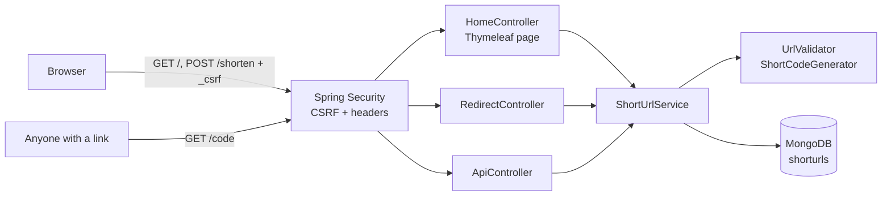

# Short URL (Java / Spring Boot)

A small, secure URL shortener built with **Java 17, Spring Boot 4, Thymeleaf and MongoDB**.
This is the Java version of the Node.js service in `../short-url`, with the same behaviour and rules.

- One-page Thymeleaf UI to create short links (with an optional custom alias)
- The UI form is protected with a **CSRF token** (Spring Security)
- Public short links (`http://host/<code>`) redirect straight to the original URL, with no cookie, session or token needed
- Basic analytics: click count and last-accessed time per link

## Documentation

| Document | What it covers |
|---|---|
| [docs/REQUIREMENTS.md](docs/REQUIREMENTS.md) | How the requirement was read, open questions and the decisions made, task breakdown |
| [docs/ARCHITECTURE.md](docs/ARCHITECTURE.md) | Components, request flows, data model, security design, key decisions, scaling notes |
| [docs/SCENARIOS.md](docs/SCENARIOS.md) | Greenfield, brownfield and ambiguous scenarios applied to the Java code |
| [docs/TESTING.md](docs/TESTING.md) | Testing approach, risks, limitations and trade-offs |
| [docs/ORCHESTRATION.md](docs/ORCHESTRATION.md) | The SDLC orchestrator: architecture, control flow, governance, metrics, CLI walkthrough, requirement mapping |

## Quick start

### 1. Prerequisites

- **JDK 17 or newer.** On macOS with Homebrew: `brew install openjdk@17`, then point `JAVA_HOME` at it:

```bash
export JAVA_HOME=/opt/homebrew/opt/openjdk@17
```

- **Maven is not needed.** The project ships the Maven Wrapper (`./mvnw`), which downloads the right Maven version on first use.
- **MongoDB 6+** running locally (see **Set up MongoDB**). If you don't have it yet, use the embedded option in step 2.

### 2. Run

**With a local MongoDB:**

```bash
./mvnw spring-boot:run
```

**Without MongoDB installed yet** (starts a temporary embedded MongoDB; data is lost on exit):

```bash
./mvnw spring-boot:run -Pembedded-mongo
```

Open http://localhost:8080.

### 3. Test

```bash
./mvnw test
```

The tests start their own embedded MongoDB, so they don't need a local install. The first run downloads a MongoDB binary (about 100 MB).

### 4. Build a runnable jar

```bash
./mvnw package
```

Then start it with `java -jar target/short-url-1.0.0.jar`.

## SDLC orchestrator

[`orchestrator/`](orchestrator) is an agentic pipeline that takes a written requirement through requirements → design → implementation → tests / security / docs → release readiness → release for this service, with human approval checkpoints, policy guardrails, retries, rollback, safe-stop, re-planning, a hash-chained audit trail and reliability metrics. It is a separate Maven project (Java 17, no Spring), run with the `./orchestrate` script, which builds it on first use.

```bash
./orchestrate scenarios
```

```bash
./orchestrate run greenfield-stats
```

```bash
./orchestrate approve <runId> release --by alex
```

Three scenarios are included (`greenfield-stats`, `brownfield-expiry`, `ambiguous-safer-links`). By default every run works in a copy of the project and releases into a sandbox under `.orchestrator/` (gitignored; delete it to reset), so `src/` is never changed unless you pass `--release-to project`. Approvers and their roles are in [orchestrator/approvers.json](orchestrator/approvers.json). Full guide: [docs/ORCHESTRATION.md](docs/ORCHESTRATION.md).

## Set up MongoDB (macOS)

```bash
brew tap mongodb/brew
brew install mongodb-community@7.0
brew services start mongodb-community@7.0
```

The default connection string (`mongodb://127.0.0.1:27017/short-url`) then works as is. The unique index on `code` is created automatically on startup.

## Configuration

All settings can be set with environment variables (see [application.yml](src/main/resources/application.yml)).

| Variable | Default | Purpose |
|---|---|---|
| `PORT` | `8080` | HTTP port |
| `MONGODB_URI` | `mongodb://127.0.0.1:27017/short-url` | MongoDB connection string |
| `BASE_URL` | `http://localhost:<PORT>` | Public base URL used to build short links |
| `CREATE_RATE_LIMIT` | `100` | Link-creation requests allowed per client IP per 15 minutes |
| `SECURE_COOKIES` | `false` | Set to `true` behind HTTPS so the session cookie is `Secure` |

## HTTP endpoints

| Method | Path | Who uses it | CSRF | Description |
|---|---|---|---|---|
| `GET` | `/` | Browser | issues token | The one-page UI |
| `POST` | `/shorten` | UI form | **required** | Create a short link. Form fields: `url`, `alias` (optional) |
| `GET` | `/{code}` | Public | no | `302` redirect to the original URL, or a `404` page |
| `GET` | `/api/urls/{code}` | Anyone | no | JSON stats for one link (click count etc.) |
| `GET` | `/health` | Monitoring | no | `{ "status": "ok" }` |

Example stats response:

```json
{
  "code": "aZ3kP9q",
  "shortUrl": "http://localhost:8080/aZ3kP9q",
  "originalUrl": "https://example.com/some/long/path",
  "clickCount": 3,
  "createdAt": "2026-10-28T10:00:00Z",
  "lastAccessedAt": "2026-10-28T10:05:00Z"
}
```

Validation errors are shown on the page with the matching HTTP status:

| Status | When |
|---|---|
| 400 | Missing, invalid, too long, non-http(s) or self-referencing URL; invalid or reserved alias |
| 403 | Missing or invalid CSRF token |
| 409 | Alias already taken |
| 429 | Too many links created from one IP |

API errors are JSON: `{ "error": { "code": "NOT_FOUND", "message": "Short URL not found." } }`. The codes match the Node version (`URL_REQUIRED`, `URL_INVALID`, `URL_TOO_LONG`, `URL_PROTOCOL_NOT_ALLOWED`, `URL_SELF_REFERENCE`, `ALIAS_INVALID`, `ALIAS_RESERVED`, `ALIAS_TAKEN`, `NOT_FOUND`).

## How it works



| Layer | Responsibility | Files |
|---|---|---|
| Config | Settings, security (CSRF, CSP) | `config/AppProperties.java`, `config/SecurityConfig.java` |
| Web | HTTP in/out only: form, redirect, JSON | `web/HomeController.java`, `web/RedirectController.java`, `web/ApiController.java` |
| Service | Business rules: validation, code generation, collision retry, click tracking | `service/ShortUrlService.java` |
| Validation | URL rules, alias rules, secure random codes | `service/UrlValidator.java`, `service/ShortCodeGenerator.java` |
| Data | Document + unique index, repository | `model/ShortUrl.java`, `repository/ShortUrlRepository.java` |
| UI | Server-rendered page, no front-end framework | `templates/index.html`, `static/css/styles.css`, `static/js/app.js` |

### Key decisions

| Decision | Reason |
|---|---|
| **CSRF via Spring Security's built-in protection** | Spring checks a token on every state-changing request. The only one is the UI form (`POST /shorten`), so CSRF applies to the UI only. Thymeleaf adds the hidden `_csrf` field to `th:action` forms automatically. |
| **Redirects need no token or session** | `GET /{code}` is read-only for the user (it only bumps a counter) and must work from email, chat, curl and so on. Tests check that it sets no cookie and creates no session. |
| **Server-rendered form with Post/Redirect/Get** | Simple Thymeleaf UI, no JavaScript needed to create links. After a successful POST the browser is redirected, so a refresh doesn't submit twice. |
| **302, not 301** | Browsers cache 301s, so repeat clicks would never reach the server and click counts would be wrong. |
| **Atomic click counting** | Lookup and `$inc` happen in one `findAndModify`, so concurrent clicks are never lost. |
| **Random codes + unique index + retry** | Codes come from `SecureRandom` (62⁷ ≈ 3.5 trillion), so they can't be guessed. The unique index catches the rare collision, and the service retries up to 5 times. |
| **"Recent links" kept in the user's session** | There are no accounts, so a global list would expose everyone's links. |
| **Strict URL rules** | Only absolute `http(s)` URLs up to 2048 characters, never this service's own host. Blocks `javascript:`/`data:` links and redirect loops. |
| **Content-Security-Policy `default-src 'self'`** | No inline scripts or styles. The one script (copy button) is a separate file. |
| **Per-IP rate limit on link creation** | Limits spam. It's in memory, so it applies per instance (see Limitations). |

## Project structure

```
short-url-java/
├── pom.xml                          # Spring Boot 4.1, Java 17; profile "embedded-mongo"
├── mvnw, mvnw.cmd, .mvn/            # Maven Wrapper (no Maven install needed)
├── src/main/java/com/example/shorturl/
│   ├── ShortUrlApplication.java
│   ├── config/                      # AppProperties, SecurityConfig
│   ├── model/ShortUrl.java          # MongoDB document
│   ├── repository/                  # Spring Data repository
│   ├── service/                     # ShortUrlService, UrlValidator, ShortCodeGenerator, errors
│   └── web/                         # Controllers, form, rate limiter, API error handler
├── orchestrate                      # Runs the SDLC orchestrator (builds it on first use)
├── orchestrator/                    # SDLC orchestrator (separate Maven project)
│   ├── pom.xml
│   ├── approvers.json               # Who may approve what (roles)
│   ├── scenarios/<id>/requirement.md
│   └── src/main/java/com/example/orchestrator/
│       ├── core/                    # Engine, graph, run store, audit log, context, policies, metrics
│       ├── workflow/                # SDLC stage templates and graph
│       ├── agents/                  # Requirements, design, implementation, test, security, docs, ...
│       ├── policies/                # Guardrail rules and write guard
│       └── scenarios/               # Reviewed change plans for the three scenarios
├── docs/                            # Requirements, architecture, scenarios, testing, orchestration
├── src/main/resources/
│   ├── application.yml
│   ├── templates/                   # index.html, not-found.html, error.html
│   └── static/                      # css/styles.css, js/app.js
└── src/test/java/...                # Unit tests + MockMvc tests with embedded MongoDB
```

## Testing

| Level | What it covers |
|---|---|
| Unit (`UrlValidatorTest`, `ShortCodeGeneratorTest`, `CreateRateLimiterTest`) | URL rules (protocols, length, self-reference), code length, characters and uniqueness, alias rules, rate-limit window |
| Web + database (`ShortUrlWebTest`) | Real HTTP flow through Spring Security and MVC to an embedded MongoDB: page has a CSRF token; POST without or with a wrong token gets 403; creation; recent links per session; alias conflict (real unique index); validation messages; cookieless redirect + click counting; 404 page; JSON stats and errors; security headers |

## Limitations and trade-offs

- No user accounts: links can't be edited, deleted or listed per user.
- The rate limiter is in memory, so the limit is per instance and resets on restart. With several instances, use a shared store (e.g. Redis, Bucket4j).
- Sessions are in memory. With several instances, use sticky sessions or Spring Session (Redis/MongoDB) so CSRF tokens and "recent links" survive across instances.
- Analytics are aggregate only (count + last access).
- `java.net.URI` is strict: URLs with unencoded spaces or some special characters are rejected and must be encoded first.
- Destination URLs aren't checked for malware or phishing.
