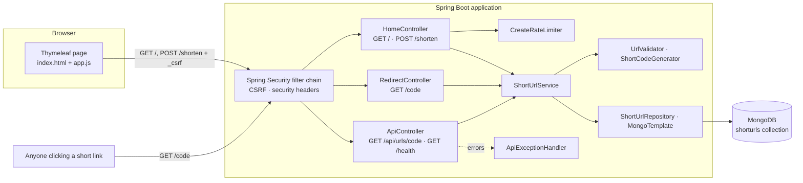
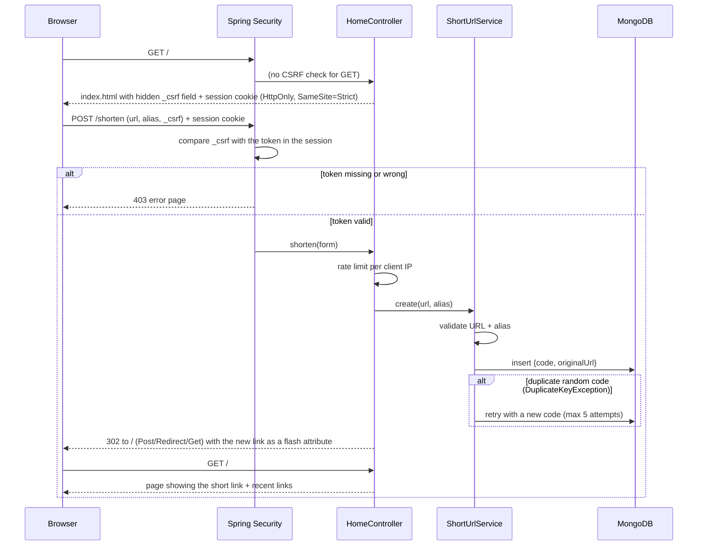
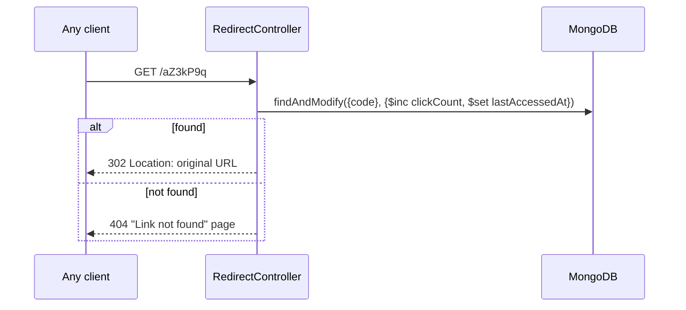

# Architecture

## 1. Components

| Layer | Responsibility | Files |
|---|---|---|
| Entry + config | Boot the app, bind settings, security rules | `ShortUrlApplication.java`, `config/AppProperties.java`, `config/SecurityConfig.java`, `application.yml` |
| Web | HTTP in/out only: render the page, read the form, redirect, JSON | `web/HomeController.java`, `web/RedirectController.java`, `web/ApiController.java`, `web/ApiExceptionHandler.java`, `web/CreateLinkForm.java`, `web/CreateRateLimiter.java` |
| Service | Business rules: validation, code generation, collision retry, click tracking | `service/ShortUrlService.java`, `service/ShortUrlView.java`, `service/ShortUrlException.java` |
| Validation | URL rules, alias rules, secure random codes | `service/UrlValidator.java`, `service/ShortCodeGenerator.java` |
| Data | Document mapping, unique index, queries | `model/ShortUrl.java`, `repository/ShortUrlRepository.java` (plus `MongoTemplate` for the atomic update) |
| UI | Server-rendered templates, one small script | `templates/index.html`, `templates/not-found.html`, `templates/error.html`, `static/css/styles.css`, `static/js/app.js` |

All classes use constructor injection, so the validators and the rate limiter can be unit-tested without Spring.

## 2. Request flows

### Create a short link (UI, CSRF protected)

If validation fails, the controller renders the page again with the error message and the matching status (400, 409 or 429). A successful create redirects, so refreshing the page never submits the form twice.

### Follow a short link (public, no CSRF)

Lookup and click counting are a single atomic MongoDB operation: one round trip, and no lost updates when the same link is clicked at the same moment. The request mapping only matches `[A-Za-z0-9_-]{3,30}`, so paths like `/favicon.ico` or `/css/styles.css` never reach it. Literal paths such as `/health` take precedence over the pattern.

## 3. Data model

Collection `shorturls` (`model/ShortUrl.java`):

| Field | Type | Notes |
|---|---|---|
| `id` | ObjectId | MongoDB `_id` |
| `code` | String | **Unique index** (`@Indexed(unique = true)`, created at startup). 7 random base62 chars, or a custom alias |
| `originalUrl` | String | Normalized ASCII form, ≤ 2048 chars |
| `customAlias` | boolean | |
| `clickCount` | long | Incremented atomically on each redirect |
| `lastAccessedAt` | Instant \| null | |
| `createdAt` | Instant | Set when the link is created |

The schema matches the Node version's collection except for field naming (`customAlias` vs `isCustomAlias`) and the absence of `updatedAt`, so the two apps should not share a database without a small migration.

## 4. Security design

| Threat | Control |
|---|---|
| Cross-site request forgery on link creation | Spring Security CSRF: a per-session token, sent in the hidden `_csrf` field that Thymeleaf adds to `th:action` forms, checked on every POST. The token is loaded lazily, so pages that don't render a form (like redirects) never create a session. The session cookie is `HttpOnly` and `SameSite=Strict`, and `Secure` when `SECURE_COOKIES=true`. |
| XSS via stored URLs (`javascript:`, `data:`) | Only `http`/`https` accepted. Thymeleaf escapes all `th:text` output by default. |
| XSS / injection in general | Content-Security-Policy `default-src 'self'` with no inline scripts or styles (the copy button is a separate file), plus Spring Security's default headers (`X-Content-Type-Options`, `X-Frame-Options`, cache control). |
| Header injection in redirects | URLs are stored in ASCII form (`URI.toASCIIString()`), so the `Location` header is always safe. |
| Redirect loops | URLs pointing at this service's own host are rejected. |
| Guessable / enumerable codes | Codes come from `SecureRandom`, 62⁷ ≈ 3.5 × 10¹² space. |
| Abuse / spam creation | Per-IP rate limit on `POST /shorten` (default 100 / 15 min) → 429. Form fields are size-limited. |
| NoSQL injection | Codes are checked against `^[A-Za-z0-9_-]{3,30}$` before any query, and queries are built with typed criteria, never strings. |
| Information leakage | Errors render generic pages (`error.html`); stack traces stay in the logs. No default user or generated password exists. |

**Why the redirect route has no CSRF:** it's a safe `GET` that changes no user-owned state (only a counter), and it must work for clients that have never loaded the UI.

## 5. Key decisions

| Decision | Alternatives considered | Reason |
|---|---|---|
| Spring Boot 4.1, Java 17, Maven Wrapper | Boot 3.5, Gradle | Boot 4 is the supported line; Java 17 is its minimum; the wrapper avoids a Maven install |
| Spring Security CSRF | Custom token filter (like the Node version) | Standard and well-reviewed, integrates with Thymeleaf automatically |
| Server-rendered form + Post/Redirect/Get | JSON API called from JavaScript | Matches "simple Thymeleaf UI"; works without JavaScript |
| `MongoTemplate.findAndModify` for redirects | Read then save via repository | One atomic round trip; no lost click updates |
| Random codes + unique index + retry | Counter + base62, hash of URL | No coordination needed, not enumerable, collisions are rare and handled |
| 302 redirects | 301 | Accurate analytics; destinations could change in future |
| Recent links in the HTTP session | Global "list all links" page | There are no accounts, so a global list would expose everyone's links |
| `java.net.URI` for URL validation | Regex, Apache Commons Validator | Built in, strict, no extra dependency |
| Embedded MongoDB (flapdoodle) for tests and `-Pembedded-mongo` | Testcontainers, mocks | No Docker needed; tests a real MongoDB, including the unique index |

## 6. Scaling notes

- The app stores two things in the HTTP session: the CSRF token and the recent-links list. With several instances, use sticky sessions or Spring Session (Redis or MongoDB).
- `CreateRateLimiter` is in memory, so it applies **per instance**. With several instances, switch to a shared limiter (e.g. Bucket4j with Redis).
- Behind a load balancer or proxy, set `server.forward-headers-strategy=native` (or `framework`) so `request.getRemoteAddr()` is the real client IP for rate limiting, and set `SECURE_COOKIES=true` with HTTPS.
- Redirect reads go through the `code` unique index. For very high traffic, add a read-through cache in front of `resolveAndTrackClick` and batch click increments.
