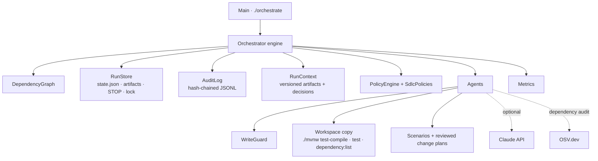
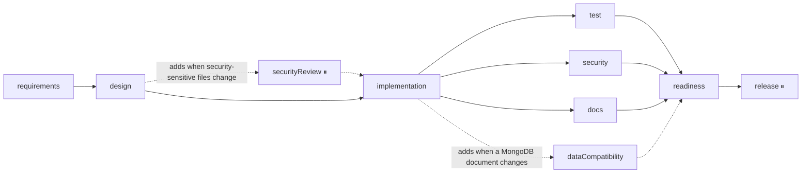
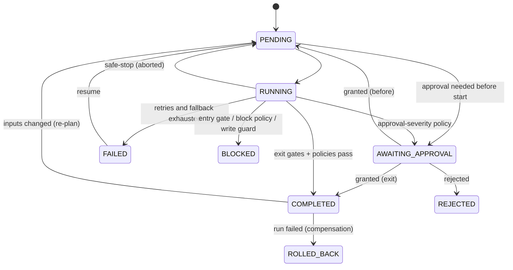

# SDLC Orchestrator

An agentic orchestration layer that takes a written requirement through the full software lifecycle (requirements → design → implementation → tests / security / docs → release readiness → release) for this Spring Boot service, with human approval checkpoints, guardrails and an audit trail.

It is a separate Maven project in [`orchestrator/`](../orchestrator) (Java 17, Jackson, JUnit; no Spring), started with the `./orchestrate` script from the project root. It is a Java port of the orchestrator in the Node.js project (`../short-url/docs/ORCHESTRATION.md`): same engine design, workflow, policies and scenarios, with agents that work on Java code through Maven.

```bash
export JAVA_HOME=/opt/homebrew/opt/openjdk@17     # JDK 17+
./orchestrate scenarios                          # list scenarios
./orchestrate run greenfield-stats               # start a run (builds the orchestrator on first use)
./orchestrate approve <runId> release --by alex  # human checkpoint, then the run resumes
```

**Principle:** agents execute under defined autonomy boundaries; humans own oversight, approvals and final quality.

| What agents may do on their own | What needs a human |
|---|---|
| Analyse the requirement, choose a reviewed change plan, analyse impact | Resolve ambiguous requirements (product owner) |
| Apply the plan in an isolated workspace copy of the project | Large changes, dependency changes, personal-data fields (tech lead / security reviewer) |
| Compile, run the test suite, security scan, docs check | Changes to security-sensitive files (security reviewer) |
| Retry, fall back, roll back their own side effects | Promote the change (release manager) |
| Add an allowed stage to the plan (security review, compatibility check) | Anything with no reviewed change plan (hand-off) |

---

## 1. Architecture



| Component | Responsibility | Code (`orchestrator/src/main/java/com/example/orchestrator/`) |
|---|---|---|
| Engine | Scheduling, gates, retries, fallback, approvals, rollback, safe-stop, re-planning | `core/Orchestrator.java` |
| Dependency graph | Validates the plan (no cycles, no unknown stages), topological order, ready stages | `core/DependencyGraph.java` |
| Run store | Persists run state atomically; artifacts; cross-process stop signal and lock | `core/RunStore.java` |
| Audit log | Append-only, hash-chained event log with verification | `core/AuditLog.java` |
| Run context | Versioned, content-hashed artifacts with lineage; decision records | `core/RunContext.java` |
| Policies | Guardrail rules (security, compliance, change control) and the write guard | `core/PolicyEngine.java`, `policies/SdlcPolicies.java`, `policies/WriteGuard.java` |
| Workflow | Stage templates (agent, inputs, outputs, gates, retries, timeout, checkpoint) and the initial graph | `workflow/SdlcWorkflow.java`, `workflow/StageTemplate.java` |
| Agents | The work of each stage | `agents/*.java`, helpers in `agents/lib/` |
| Artifacts | Typed records passed between stages (`Spec`, `Design`, `ChangeSet`, reports...) | `artifacts/Artifacts.java` |
| Scenarios | Requirement documents + reviewed change plans | `scenarios/*.java`, requirement files in `orchestrator/scenarios/<id>/requirement.md` |
| Metrics, CLI | Reliability metrics, console output, commands | `core/Metrics.java`, `core/ConsoleLogger.java`, `Main.java` |

Runtime data lives in `.orchestrator/runs/<runId>/` (gitignored): `state.json`, `audit.jsonl`, `artifacts/`, `workspace/`, `changes.patch`, `ENGINEERING_SUMMARY.md`, and for releases `release-target/`, `release-backup/`, `release-manifest.json`. Delete `.orchestrator/` to reset.

---

## 2. Orchestration model and control flow

### The SDLC graph



`test`, `security` and `docs` run in parallel; `readiness` waits for all of them (synchronization).

### Scheduler

The scheduler loop runs on the calling thread. Every 100 ms it:

1. checks for a safe-stop request (a `STOP` file written by `./orchestrate stop`, so it works from another terminal);
2. starts every **ready** stage (pending, and every upstream stage completed) on a worker thread, up to the concurrency limit (3);
3. exits when nothing is running and nothing can start.

Agents run outside any lock. Every change to the run state happens inside `synchronized (run)`, and the state file is rewritten atomically after each change.

### Stage lifecycle



### Inside one stage

1. **Entry gates** (preconditions) → `BLOCKED` if any fails.
2. **Approval before** (high-impact stages such as `release`) → `AWAITING_APPROVAL` unless an approval exists for exactly these inputs.
3. **Agent attempts** with timeout, retries and fallback (§3). Each attempt is checked by the **exit gates**.
4. Outputs stored as new artifact versions (only if the content changed); decisions recorded.
5. **Policies** evaluated: `block` → `BLOCKED`; `approval` → `AWAITING_APPROVAL` (bound to the output fingerprint); `warn` → recorded.
6. **Plan changes** proposed by the agent applied (§4), then `COMPLETED`, and stale downstream stages re-queued.

### Entry and exit gates

| Stage | Entry gate | Exit gate |
|---|---|---|
| requirements | requirement document not empty | spec has criteria or open questions |
| design | ambiguities resolved (clarification exists) | every acceptance criterion traced to a task |
| implementation | design is automatable | **workspace compiles** (`mvn test-compile`); at least one file changed |
| dataCompatibility | | backward compatible |
| test | | all tests pass (Surefire reports) and at least one ran |
| docs | | every documentation expectation met |
| readiness | | verdict is `ready` |
| release | readiness verdict is `ready` | |

---

## 3. Reliability controls

| Control | How it works |
|---|---|
| Bounded retries | Per-stage `maxAttempts` (test: 3, implementation/security/requirements: 2), exponential backoff (250 ms doubling, max 4 s), and a run-wide retry budget (10). Non-retryable errors (compile errors, missing anchors, refusals) skip straight to the fallback. |
| Timeouts | Per-stage timeout (e.g. tests 10 min). On timeout the stage's stop signal fires, Maven child processes are killed, and the attempt counts as a retryable failure. |
| Fallback | `requirements-llm` → rule-based `requirements`; `security` (with OSV.dev dependency audit) → `security-offline` (static checks only, recorded as SEC-003 warning). Policy violations never fall back. |
| Rollback (compensation) | When a run fails, completed stages with side effects are rolled back newest first: `release` restores the release target from its backup; `implementation` deletes the workspace. `release` also restores its own backup immediately if post-release verification fails. |
| Safe-stop | `./orchestrate stop <runId>` (any terminal). In-flight agents are signalled, Maven processes killed, aborted stages return to `PENDING`, and the run is `STOPPED` and resumable. The engine also safe-stops on engine errors, on "no stage can make progress", and when the audit trail fails verification. |
| Single writer | A lock file with the owner PID prevents two processes from driving the same run; stale locks from crashed processes are taken over. |
| Failure drills | `--inject <stage>=<n>` fails the first n attempts; `--fail-release-verify` makes post-release verification fail, to exercise rollback. |

---

## 4. Re-planning

Every stage records an **input fingerprint**: a hash of the exact versions of the artifacts it consumed plus any reviewer note. Artifacts are content-hashed and only get a new version when their content changes.

- **Upstream input changed:** the requirement document is re-read on every `run`/`resume`. If it changed, `requirementSource` gets a new version, and any completed stage whose fingerprint no longer matches is reset (rolled back first if it had side effects).
- **Memoization:** if a re-run stage produces identical output, downstream fingerprints still match and downstream stages are reused. Editing a typo in the requirement re-runs `requirements` and whatever actually consumes the changed text, nothing more.
- **Upstream-incomplete rule:** a stage only starts when all of its upstream stages (not just direct dependencies) are complete, so nothing runs on top of a stage that is being re-planned.
- **Approvals are bound to fingerprints:** a "before" approval counts only for the same inputs; an "exit" approval only for the same outputs. Changed inputs mean a new approval is requested; identical outputs reuse the existing one.
- **Human re-plan:** `./orchestrate replan <runId> --from design --by sam --note "..."` adds a note to that stage's fingerprint, so the stage re-runs with the note available to its agent.
- **Resume after failure:** `resume` resets failed, blocked, rejected and rolled-back stages to pending and continues.

### Agent plan changes

Agents may propose new stages (`PlanChange.addStage`). The engine accepts only templates the workflow lists as agent-addable (`securityReview`, `dataCompatibility`). Anything else is rejected by **CHG-007** and the stage is blocked. The new graph must stay acyclic. Stages a re-run no longer asks for are removed.

The design agent uses this to:

- add `securityReview` (human sign-off) before `implementation` when the plan touches `SecurityConfig.java`, `AppProperties.java`, `application.yml` or `pom.xml`;
- add `dataCompatibility` before `readiness` when the plan changes a class under `model/` (a MongoDB document).

---

## 5. Governance: human checkpoints and policies

### Roles and checkpoints

Approvers and their roles are in [`orchestrator/approvers.json`](../orchestrator/approvers.json):

| Approver | Roles |
|---|---|
| alex | product-owner, release-manager |
| sam | security-reviewer, tech-lead |

`approve` / `reject` check the approver has one of the roles the checkpoint requires. Approvals with options (ambiguity clarification) require `--choice`, and the choice becomes the `requirements.clarification` artifact that design consumes.

| Checkpoint | Kind | Role | Trigger |
|---|---|---|---|
| Clarify requirement | exit | product-owner | REQ-001 (ambiguities found) |
| Large change | exit | tech-lead | CHG-001 (> 8 files or > 400 lines) |
| Dependency change | exit | tech-lead | CMP-002 (`pom.xml` changed) |
| Personal data | exit | security-reviewer | CMP-001 (new `ip`/`email`/`userAgent`/... field in a document) |
| Security review | before | security-reviewer | `securityReview` stage added by design |
| Release | before | release-manager | always, before `release` |

### Policy rules (`policies/SdlcPolicies.java`)

| Rule | Category | Severity | Stage | Checks |
|---|---|---|---|---|
| REQ-001 | change-control | approval | requirements | No unresolved ambiguities |
| CHG-008 | change-control | block | design | A reviewed change plan exists (else hand-off) |
| CHG-001 | change-control | approval | design | Change size within limits |
| CMP-001 | compliance | approval | implementation | No new personal-data fields in documents |
| CMP-002 | compliance | approval | implementation | `pom.xml` unchanged |
| SEC-002 | security | block | implementation | Security-sensitive files only changed after a completed `securityReview` |
| SEC-001 | security | block | security | No high/critical findings (static rules, invariants, vulnerable dependencies) |
| SEC-003 | security | warn | security | Dependency audit ran |
| CHG-005 | change-control | block | test | Number of test methods did not go down |
| REL-001 | change-control | block | readiness | Every acceptance criterion traced to a task |
| CHG-003 / CHG-004 | change-control | block | every write | Relative paths inside the workspace; protected files (`.env*`, `mvnw`, `.mvn/`, `target/`, `orchestrator/`, `.orchestrator/`, `orchestrate`) never written |
| CHG-007 | change-control | block | plan changes | Agents only add allowed stage templates |

A rule that throws is treated as a violation (fail closed).

### Security checks (`agents/SecurityAgent.java`)

- **Static rules** on changed files: shell execution from app code, hard-coded credentials or secrets, `th:utext` (unescaped Thymeleaf output), non-cryptographic randomness, open redirects from request input.
- **Invariants** that must survive any change: `SecurityConfig` still configures `.csrf(...)` and does not disable it; the Content-Security-Policy is still set.
- **Dependency audit:** `mvn dependency:list` (runtime scope), then the OSV.dev batch API; GitHub-advisory severities map to high/critical findings.

---

## 6. Observability and metrics

### Audit trail

Every event is appended to `audit.jsonl`: `seq`, timestamp, type, actor (`engine`, `agent:<name>`, `human:<name>`), stage, attempt, data, previous hash and own hash. Event types include `run.*`, `stage.*`, `attempt.*`, `gate.*`, `policy.evaluated`, `approval.*`, `artifact.recorded`, `decision.recorded`, `retry.scheduled`, `fallback.used`, `rollback.*`, `plan.stage_added/removed`, `replan.*` and `agent.log`.

```bash
./orchestrate audit <runId>              # list + verify the chain
./orchestrate lineage <runId> engineeringSummary   # which artifact versions and decisions led here
./orchestrate graph <runId>              # current graph as Mermaid, with stage status
```

Editing, deleting or reordering any line breaks the chain. `audit` reports where, and `execute`/`resume` refuse to continue (safe-stop).

### Metrics (`core/Metrics.java`)

| Metric | Definition |
|---|---|
| Success rate | completed runs / (completed + failed) |
| First-pass yield | stage executions that passed on their first attempt |
| Retry frequency | retries / all attempts |
| Rollback frequency | runs with at least one rollback / runs started |
| Fallbacks used | count of `fallback.used` events |
| MTTR | mean time from a stage's first failure to its next completion (retry, fallback, or human fix + resume) |
| End-to-end latency | run start → finish, also excluding time spent waiting for approvals |
| Approval wait | mean time from approval request to decision |
| Policy findings | violations by severity |

```bash
./orchestrate metrics
```

---

## 7. Agents

| Agent | Stage | What it does |
|---|---|---|
| `requirements` | requirements | Rule-based: acceptance criteria from the "Acceptance criteria" section (or derived from should/must sentences), ambiguities from a knowledge base of vague terms (`agents/Interpretations.java`), keywords |
| `requirements-llm` | requirements (`--llm`) | Claude produces the same spec (structured output) |
| `design` | design | Picks the matching reviewed change plan, analyses impact on the Java code (which classes import or use each changed class; related files by keyword), traces criteria to tasks, adds stages when needed, or produces a hand-off |
| `implementation` | implementation | Copies the project to a workspace, applies the plan through the write guard, runs `./mvnw test-compile`, writes per-file diffs and `changes.patch` |
| `test` | test | `./mvnw test` in the workspace; reads `target/surefire-reports/TEST-*.xml`; counts test methods before/after |
| `security` / `security-offline` | security | Static rules + invariants, plus the OSV.dev dependency audit in full mode |
| `docs` | docs | Plan expectations plus derived ones: new `${ENV_VAR}` in `application.yml` and new `@GetMapping`/`@PostMapping` paths must appear in the README |
| `compatibility` | dataCompatibility | Document changes: no removed/renamed fields; a new unique index needs `sparse = true`; notes how old documents read new fields |
| `review-gate` | securityReview | Records who signed off (the work is the approval itself) |
| `readiness` | readiness | Verdict + `ENGINEERING_SUMMARY.md` |
| `release` | release | Copies changed files to the release target (sandbox copy by default, or the project with `--release-to project`), backs up what it overwrites, verifies with `./mvnw test`, restores on failure |

All Maven calls use the JDK the orchestrator runs on (`JAVA_HOME` is set for child processes) and the shared `~/.m2` cache.

### Optional Claude agent

`./orchestrate run <scenario> --llm` uses `requirements-llm` (`claude-opus-5-5`, Anthropic Java SDK, structured output derived from the `LlmSpec` record). It needs `ANTHROPIC_API_KEY`. On any failure (missing credentials, API error, refusal, unparseable output) the engine retries if the error is transient and then falls back to the rule-based agent, so runs still complete without it. The server-side `fallbacks` parameter is not used because the engine's own fallback already covers refusals.

### Scenarios and change plans

A scenario is a requirement document plus one or more **reviewed change plans** (`scenarios/GreenfieldStatsPlan.java`, `BrownfieldExpiryPlan.java`, `SaferLinksPlans.java`). A plan lists its approach, alternatives considered, tasks (with dependencies and keywords for traceability), refined criteria, risks, assumptions, rollback plan, documentation expectations, and the file operations: `create` (new file) or `replace` (the anchor text must occur exactly once). If the code changed since the plan was written, the anchor check fails and the run stops for review instead of guessing.

---

## 8. CLI walkthrough

### Greenfield

```bash
./orchestrate run greenfield-stats
# requirements → design → implementation (compiles) → test ∥ security ∥ docs → readiness
# ⏸ release needs approval (release-manager)
./orchestrate approve <runId> release --by alex --reason "Reviewed summary and patch"
# release: promoted 4 file(s) to .orchestrator/runs/<runId>/release-target, verified with mvn test
```

### Brownfield, with a failure drill

```bash
./orchestrate run brownfield-expiry --inject test=1
# ⏸ design needs approval (tech-lead): [CHG-001] Change touches 12 files
./orchestrate approve <runId> design --by sam
# + plan: added stage "dataCompatibility"; test attempt 1 fails (drill) and is retried
./orchestrate approve <runId> release --by alex
```

### Ambiguous

```bash
./orchestrate run ambiguous-safer-links
# ⏸ requirements needs approval (product-owner): "safer" … Options: domain-blocklist, interstitial-warning, link-expiry
./orchestrate approve <runId> requirements --by alex --choice domain-blocklist
# + plan: added stage "securityReview" (AppProperties.java, application.yml)
./orchestrate approve <runId> securityReview --by sam
./orchestrate approve <runId> release --by alex
```

With `--choice interstitial-warning` the design stage finds no reviewed plan, CHG-008 blocks the run, and `status` lists the hand-off tasks.

### More drills

```bash
./orchestrate run greenfield-stats --inject security=2 --fail-release-verify   # fallback, then release rollback
./orchestrate stop <runId> --by sam --reason "incident"                         # from another terminal while it runs
./orchestrate resume <runId>                                                    # continues; completed stages are not redone
# edit orchestrator/scenarios/greenfield-stats/requirement.md, then:
./orchestrate resume <runId>                                                    # re-plans only what changed
./orchestrate replan <runId> --from design --by sam --note "keep the API unchanged"
./orchestrate audit <runId>
./orchestrate metrics
```

---

## 9. Requirement mapping

How each item in the assignment brief is covered.

| Assignment requirement | Where it is implemented |
|---|---|
| 1. Requirement understanding (interpret, find ambiguity, normalize) | `RequirementsAgent`, `LlmRequirementsAgent`, `Interpretations`; REQ-001 clarification checkpoint; `Spec` artifact |
| 2. Task decomposition (tasks, dependencies, sequencing) | Change plan tasks with dependencies; `Design` artifact; `criteria-traceable` gate; REL-001; [REQUIREMENTS.md](REQUIREMENTS.md) for the app itself |
| 3. Codebase reasoning (impacted modules, data flows) | `DesignAgent` + `agents/lib/Codebase.java` (classes that import or use a changed class, related files); `dataCompatibility` and `securityReview` added from the impact; impact table in the summary |
| 4. Workflow orchestration: dependency graph with entry/exit gates | `DependencyGraph`, `SdlcWorkflow`, gates in `Orchestrator.runStage` / `executeWithRetries` |
| ↳ sequential and parallel paths with synchronization | `schedule()` + `readyStages()` (all upstream complete), worker pool with a concurrency limit |
| ↳ cross-stage context and decision lineage | `RunContext` (versioned artifacts, `derivedFrom`, decisions), `lineage` command |
| ↳ human approval for high-impact actions | `approvalBefore`, approval-severity policies, roles in `approvers.json` |
| ↳ bounded retries, fallback, rollback, safe-stop | §3 |
| ↳ policy guardrails (security, compliance, change control) | `SdlcPolicies`, `WriteGuard`, CHG-007 in the engine, security invariants |
| ↳ audit-grade observability and traceability | `AuditLog` (hash chain + verify), `audit` command |
| ↳ reliability metrics (success rate, retry/rollback frequency, MTTR, latency) | `Metrics`, `metrics` command |
| ↳ dynamic re-planning with governance | Fingerprints, memoization, `replan`, agent plan changes limited to allowed templates (§4) |
| 5. Engineering output (code, schemas, tests, docs) | Change set + `changes.patch`; new tests in each plan; docs checks; the Spring Boot service in `src/` |
| 6. Validation and risk control | Compile, test, security, docs, compatibility stages; block policies; risks in each plan and in the summary |
| 7. Controlled autonomy | Isolated workspace, write guard, sandbox release by default, approvals, autonomy table at the top |
| 8. Final engineering summary | `ReadinessAgent` → `ENGINEERING_SUMMARY.md` (requirement, plan and rationale, impact, artifacts, validation, policies, risks, assumptions, limitations, rollback plan, approvals and decisions) |
| Deliverable: working prototype | `./mvnw spring-boot:run -Pembedded-mongo` (app), `./orchestrate` (orchestrator) |
| Deliverable: architecture overview | [ARCHITECTURE.md](ARCHITECTURE.md) (app), this document (orchestrator) |
| Deliverable: three scenarios | [SCENARIOS.md](SCENARIOS.md); executable with `./orchestrate run <scenario>` |
| Deliverable: setup instructions | [README.md](../README.md) |
| Deliverable: testing, limitations, trade-offs | [TESTING.md](TESTING.md) and §10 below |

---

## 10. Limitations and trade-offs

| Limitation / trade-off | Why, and what would change it |
|---|---|
| Change plans are written and reviewed by engineers; agents do not generate code | Keeps autonomy bounded and every change reviewable. A code-generating agent could produce plans, but its plans would then go through the same compile/test/policy gates and human approvals. |
| Requirements with no matching plan are handed off (CHG-008) | Safer than guessing; the hand-off lists what a human needs to do. |
| Single-process scheduler with a file lock | Simple and enough for one pipeline; a shared queue and workers would be needed for many concurrent runs. |
| File-based store and audit log | The hash chain detects edits, deletions and reordering, but nothing anchors the latest hash externally, so rewriting the whole file would go undetected. Shipping hashes to an external log would close that. |
| Pattern-based static security rules | Catch common mistakes and enforce invariants; a real SAST tool (e.g. SpotBugs/Find Security Bugs, Semgrep) would go deeper. |
| OSV.dev severities | Only GitHub-advisory entries carry a severity label; others are treated as medium. Network is required (fallback otherwise). |
| One clarification choice per approval | Only the first ambiguity's options are offered. |
| Keyword-based traceability | Criteria are linked to tasks by keywords in the plan; good enough for reviewed plans, not semantic. |
| Approver identity is a CLI flag | Roles are enforced, but identity is not authenticated (would come from SSO in a real deployment). |
| Each test/release stage runs the full Maven test suite | ~7-12 s per run here; slower suites would need test selection or caching. |
| Artifact lineage points to the version an artifact was first produced from | Identical content is not re-versioned, so after a re-plan that changes nothing downstream, lineage shows the inputs of the original version. |
