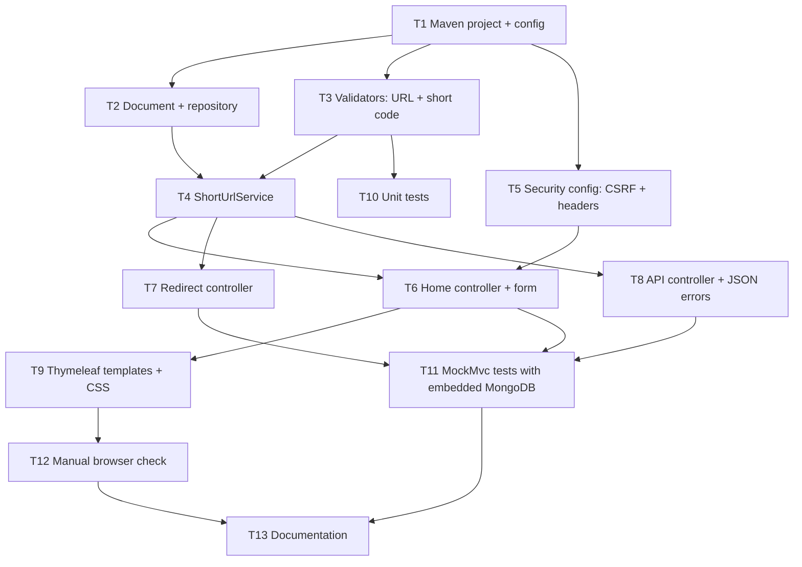

# Requirements: understanding and decomposition

## 1. The original requirement

From the request:

1. Build the URL shortener in **Java with Spring Boot**, with code that is easy for people to read
2. Use MongoDB as the backend (a local instance; not set up yet)
3. Provide a one-page UI to create short URLs, using **Thymeleaf**
4. Secure the UI with a CSRF token, **only for the UI**
5. Public short URLs must keep working as they are: hitting a short URL redirects to the original URL

Behaviour must match the Node.js version in `../short-url`. The assignment brief adds: core APIs, **analytics**, **reliability**, production-quality code, tests and documentation.

## 2. Normalized problem statement

> Build an HTTP service that stores a mapping `code → original URL` in MongoDB.
> A server-rendered Thymeleaf form (protected against cross-site request forgery) creates mappings.
> Anyone can open `BASE_URL/<code>` with no session or token and gets an HTTP redirect to the original URL.
> Each redirect is counted. The service validates input, resists abuse and is covered by automated tests.

## 3. Ambiguities and the decisions made

| # | Question | Decision | Why |
|---|---|---|---|
| A1 | "CSRF only for UI": which endpoints count as UI? | Only the UI form submit (`POST /shorten`) checks the token. Redirects, stats and health are GETs and don't use CSRF. | CSRF protects state-changing requests made with ambient cookies. Redirects must work from email, chat, curl and so on, where no token can exist. |
| A2 | Which CSRF mechanism? | **Spring Security's built-in CSRF protection** (token stored in the HTTP session, sent as the hidden `_csrf` form field). | Standard, well-reviewed, and Thymeleaf inserts the field automatically for `th:action` forms. No custom security code to maintain. The Node version needed its own middleware because `csurf` is deprecated. |
| A3 | JSON API or a form post for creating links? | **Form post** with Post/Redirect/Get. A JSON stats endpoint stays for analytics. | "Simple UI with Thymeleaf" points to a server-rendered form; no JavaScript is needed to create links. |
| A4 | Is there also a public (non-UI) API for creating links? | **No.** Creating links happens only through the UI. | Not requested. A public write API would need its own auth (API keys). See the future scenario in [SCENARIOS.md](SCENARIOS.md). |
| A5 | Users / login? | **None.** Links are anonymous. Spring Security's login, basic auth and logout are disabled. | Not requested. Abuse is limited by rate limiting instead. |
| A6 | Custom aliases? | **Optional** alias, 3-30 chars `[A-Za-z0-9_-]`, reserved words blocked (`api`, `static`, `health`, `css`, `js`, `error`, `shorten`), `409` on conflict. | Same rules as the Node version, plus the paths this app uses for static files and the form. |
| A7 | Same long URL submitted twice: same code or a new one? | **A new code each time.** | Keeps per-link analytics separate and avoids revealing that someone else already shortened a URL. |
| A8 | 301 or 302 redirect? | **302.** | Browsers cache 301s, so repeat clicks would never reach the server and analytics would undercount. |
| A9 | Which URLs are allowed? | Absolute `http(s)` only, max 2048 chars, never this service's own host. | Blocks `javascript:`/`data:` XSS vectors and redirect loops. |
| A10 | Where does "Your recent links" live? | In the user's **HTTP session** (last 10 codes), with live click counts read from MongoDB. | There are no accounts. The Node version used `localStorage`; the session already exists here for CSRF. |
| A11 | MongoDB isn't installed locally. | Docs include install steps. `-Pembedded-mongo` and the test suite use an embedded MongoDB. | The app can be run and tested right away. |
| A12 | Which Java and Spring versions? | **Java 17, Spring Boot 4.1.** Maven Wrapper included. | Boot 4 is the supported line (3.5 is past open-source support). Java 17 is the minimum for Boot 4 and is installed locally. The wrapper means no Maven install is needed. |

## 4. Task breakdown

Each task has a done-condition; arrows are dependencies.

| Task | Output | Done when |
|---|---|---|
| T1 | `pom.xml`, Maven Wrapper, `application.yml`, `AppProperties` | App boots; settings come from environment variables |
| T2 | `model/ShortUrl.java`, `repository/ShortUrlRepository.java` | Unique index on `code` exists |
| T3 | `service/UrlValidator.java`, `service/ShortCodeGenerator.java` | Bad URLs/aliases rejected with clear error codes |
| T4 | `service/ShortUrlService.java` | Create (with collision retry), atomic resolve + count, stats |
| T5 | `config/SecurityConfig.java` | Form POST without a valid token gets 403; strict CSP header set |
| T6 | `web/HomeController.java`, `web/CreateLinkForm.java`, `web/CreateRateLimiter.java` | Can create a link; errors shown on the page with the right status |
| T7 | `web/RedirectController.java` | `GET /{code}` → 302, unknown → 404 page, no session created |
| T8 | `web/ApiController.java`, `web/ApiExceptionHandler.java` | JSON stats and JSON errors |
| T9 | `templates/*.html`, `static/*` | Page matches the Node UI; copy button works |
| T10-T11 | `src/test/**` | `./mvnw test` green |
| T12 | Manual run via `./mvnw spring-boot:run -Pembedded-mongo` | Create → click → count increments; curl POST without token → 403 |
| T13 | `README.md`, `docs/*` | Setup, architecture, scenarios, testing documented |

**Parallel paths:** T2, T3 and T5 only depend on T1 and can be built at the same time. T6, T7 and T8 are independent of each other once the service exists. Unit tests (T10) can start as soon as T3 lands.
